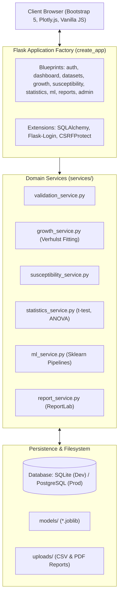

# BioSense: Intelligent Microbial Growth & Antibiotic Susceptibility Analytics Platform

> **Turning Biological Data into Intelligent Insights.**

[](https://www.python.org/)
[](https://palletsprojects.com/p/flask/)
[](https://scikit-learn.org/)
[](https://www.reportlab.com/)
[-brightgreen.svg)](https://pytest.org/)
[](LICENSE)

---

## 1. Project Overview & Educational Mission

**BioSense** is a full-stack computational biotechnology platform designed for microbial growth kinetics modeling, clinical-standard antibiotic susceptibility testing (AST) analysis, dynamic machine learning pipelines, anomaly screening, and automated PDF report compilation.

Developed as a **4th-Year Major Project for BCA (Data Science)**, BioSense bridges software engineering with laboratory data science. It enables students and researchers to understand, visualize, and defend the mathematical and predictive principles of microbial dynamics.

```
       Bacterial Growth Kinetics                   Antibiotic Susceptibility Testing
     OD600                                       Inhibition Zone Diameter (mm)
       ^         Log Phase                          +-------------------------+
       |           /---\   Stationary               | S: Sensitive  (>=22 mm) |
       |          /     \                           | I: Intermed.  (17-21 mm)|
       |   Lag   /       \                          | R: Resistant  (<=16 mm) |
       |  ----__/         \  Decline                +-------------------------+
       +----------------------------> Time (h)
```

---

## 2. Mandatory Scientific & Clinical Disclaimer

> [!WARNING]
> **EDUCATIONAL & RESEARCH NOTICE:**
> BioSense is an educational and academic research analytics platform. It is **NOT** a certified medical device, clinical diagnostic tool, or patient management decision support system.
> 
> * Susceptibility metrics reflect empirical distributions within specific datasets.
> * Machine learning feature importances reflect statistical associations, **not biological causation**.
> * Platform conclusions follow non-prescriptive, dataset-derived wording (e.g., *"Within the analyzed dataset, Antibiotic X had the highest proportion of observations categorized as Sensitive for Organism Y"*).
> * **Never use BioSense outputs for clinical diagnosis, patient treatment, or drug prescription.**

---

## 3. Key Features & Capabilities

### 1. Ingestion & Quality Control Pipeline
* **CSV Schema Validation**: Automated column mapping and type verification for growth time-series and AST records.
* **Biological Range Screening**: Rejection or flagging of impossible values (negative OD600, pH outside 0.0–14.0, temperature < 0°C).
* **Data Cleaning & Auditing**: Median imputation, duplicate deduplication, and **CSV formula injection protection** (`=, +, -, @` escaping).
* **Provenance Tracking**: Tagging every record as `Synthetic – Demonstration Data`, `Public Dataset`, or `User-Uploaded`.

### 2. Microbial Growth Kinetics Engine
* **Non-linear Curve Fitting**: Fits time vs. OD600 measurements to the **Verhulst Logistic Growth Equation**:
  $$N(t) = \frac{K}{1 + \left(\frac{K - N_0}{N_0}\right) e^{-r t}}$$
* **Kinetics Parameters**: Calculates initial OD ($N_0$), carrying capacity ($K$), specific growth rate ($\mu_{max}$ from log-linear exponential slope), doubling time ($t_d = \frac{\ln 2}{\mu_{max}}$), and time to peak OD.
* **Interactive Logistic Simulator**: Real-time simulation tool with validated inputs ($N_0 > 0, K > N_0, r > 0$) labeled: *"Mathematical simulation, not a laboratory prediction."*

### 3. Antibiotic Susceptibility Testing (AST) Analytics
* **Clinical Breakpoints**: Categorizes results into Sensitive (S), Intermediate (I), and Resistant (R) following CLSI M100 and EUCAST Kirby-Bauer disk diffusion criteria.
* **Comparative Visualizations**: Interactive Plotly donut charts, resistance rate benchmarks, and cross-organism comparisons.

### 4. Inferential Statistics & Bio Explorer
* **Descriptive Statistics**: Central tendency, dispersion, variance, and IQR across continuous parameters.
* **Hypothesis Testing**: **Welch's unequal variances t-test** and **One-Way ANOVA** with underlying mathematical assumptions explained on-page.
* **Correlation Heatmap**: Interactive Pearson correlation matrix across incubation conditions and biological responses.
* **Bio Explorer Directory**: Database-driven catalog of microbial taxa, standard Gram staining, and observed susceptibility histories.

### 5. Machine Learning Lab & Target Leakage Awareness
* **Dual Classification Formulations**:
  * **Variant A (Zone Diameter Included)**: Baseline model achieving ~100% accuracy due to target leakage (zone diameter directly determines AST category).
  * **Variant B (Genuine Predictive Model - Zone Diameter Excluded)**: Predicts susceptibility solely from pre-experimental biological features (`organism`, `gram_type`, `antibiotic`, `temp`, `pH`).
* **Regression Modeling**: Predicts OD600 growth progression using `Ridge` and `RandomForestRegressor`.
* **Model Explainability**: Permutation feature importance analysis with prominent disclaimer that statistical importance $\ne$ biological causation.
* **Anomaly Detection**: Outlier screening via IQR, Z-Score ($|Z| > 2.8$), and unsupervised **Isolation Forest**.

### 6. Automated 13-Section PDF Dossier Engine
* **Publication-Quality PDFs**: Compiles multi-page dossiers via **ReportLab 5.0** and headless **Matplotlib Agg** vector charts.
* **13 Standardized Sections**: Title & Metadata, Executive Summary & Disclaimer, Dataset Provenance, Organism Profile, Culture Parameters, Kinetics Table, Growth Curve Plot, AST Profile, Susceptibility Donut Chart, Descriptive Statistics, ML Pipeline Inferences, Anomaly Screening, and Methodological Viva References.
* **Running Headers & Footers**: Two-pass canvas with total page count (`NumberedCanvas`) and permanent clinical warning.

---

## 4. System Architecture & Tech Stack



| Component | Technology | Role |
| :--- | :--- | :--- |
| **Backend Framework** | Python 3.10+ / Flask 2.3 | Application factory, blueprints, routing |
| **ORM & Database** | Flask-SQLAlchemy / SQLite / PostgreSQL | Relational persistence, 12 normalized models |
| **Authentication & RBAC**| Flask-Login / Werkzeug | Session security, password hashing, role gates |
| **Security & CSRF** | Flask-WTF / CSRFProtect | Token protection, CSV formula escaping |
| **Scientific Computing** | NumPy, SciPy, Pandas | Curve fitting, ANOVA, data cleaning |
| **Machine Learning** | Scikit-Learn 1.3+ | Pipelines, ColumnTransformer, IsolationForest |
| **PDF Reporting** | ReportLab 5.0 / Matplotlib (Agg) | Headless vector document rendering |
| **Frontend** | Jinja2, HTML5, CSS3, Bootstrap 5, Plotly.js | Responsive biotech UI, dark/light theme |
| **Test Suite** | Pytest 8.x | 41 unit & integration tests |
| **WSGI Server** | Gunicorn | Production web server |

---

## 5. Project Directory Structure

```text
biosense/
├── app.py                      # Application factory & runner
├── config.py                   # Development, testing, production configurations
├── extensions.py               # Instantiation of db, login_manager, csrf
├── requirements.txt            # Pinned dependencies
├── Procfile                    # Render / Heroku WSGI command
├── render.yaml                 # Render cloud deployment blueprint
├── .env.example                # Environment variable template
├── .gitignore                  # Git hygiene rules
├── LICENSE                     # MIT License
├── README.md                   # This master documentation
├── PROGRESS.md                 # Milestone delivery audit log
├── database/
│   ├── __init__.py
│   └── models.py               # 12 SQLAlchemy models & relationships
├── datasets/
│   ├── sample_growth.csv       # 1,950-row seeded synthetic growth dataset
│   ├── sample_susceptibility.csv # 1,200-row seeded synthetic AST dataset
│   └── sample_dirty_growth.csv # Raw dataset with missing values & duplicates
├── models/                     # Saved Scikit-Learn .joblib artifacts
├── routes/                     # Blueprint controllers (thin routes)
│   ├── main.py                 # Landing page & health check
│   ├── auth.py                 # RBAC, login, registration
│   ├── dashboard.py            # KPI aggregation & visualization API
│   ├── datasets.py             # CSV upload, validation, cleaning, import
│   ├── growth.py               # Growth curves, phase analysis, simulation
│   ├── susceptibility.py       # AST categorization, resistance statistics
│   ├── statistics.py           # Descriptive stats, t-test, ANOVA, Bio Explorer
│   ├── ml.py                   # Model training, comparison, prediction, explainability
│   ├── reports.py              # 13-section PDF generator & streaming
│   └── admin.py                # Reference catalog editor & audit log viewer
├── services/                   # Core business logic & algorithms
│   ├── auth_service.py         # Authentication & audit logs
│   ├── validation_service.py   # Ingestion schema rules & anomaly checks
│   ├── cleaning_service.py     # Missing value, duplicate, formula protection
│   ├── growth_service.py       # Curve fitting, mu_max, doubling time
│   ├── susceptibility_service.py # AST categorization, resistance calculations
│   ├── statistics_service.py   # Statistical tests, correlations, summaries
│   ├── ml_service.py           # Sklearn pipelines, classification, regression
│   ├── anomaly_service.py      # IQR, Z-score, Isolation Forest
│   └── report_service.py       # 13-section ReportLab PDF builder
├── templates/                  # Semantic HTML5 Jinja2 templates
│   ├── base.html               # Master layout with navbar, theme toggle, footer
│   ├── index.html              # Biotech SaaS landing page
│   ├── auth/                   # login.html, register.html, profile.html
│   ├── dashboard/              # dashboard.html (6 KPIs, 8 charts)
│   ├── datasets/               # upload.html, validate.html, cleaned.html
│   ├── growth/                 # growth.html, simulator.html
│   ├── susceptibility/         # susceptibility.html
│   ├── statistics/             # statistics.html, bio_explorer.html
│   ├── ml/                     # classification.html, regression.html, compare.html, explain.html, anomaly.html
│   ├── reports/                # reports.html, view_report.html
│   ├── admin/                  # admin.html, audit_logs.html, organisms.html, antibiotics.html
│   └── errors/                 # 403.html, 404.html, 500.html
├── static/
│   ├── css/biosense.css        # Biotechnology design system & dark/light styles
│   └── js/main.js              # Theme switcher & client interactions
├── scripts/
│   ├── create_admin.py         # Secure CLI tool for creating ADMIN account
│   ├── generate_sample_data.py # Seeded synthetic data generator (seed=42)
│   └── seed_db.py              # Database populator (reference catalogs & demo data)
├── tests/                      # Automated Pytest suite (41 tests)
│   ├── conftest.py             # Pytest fixtures & isolated testing db
│   ├── test_foundation.py      # Config & health checks
│   ├── test_landing_page.py    # Public landing page elements
│   ├── test_auth.py            # RBAC, login, registration, security tests
│   ├── test_reference_data.py  # Microbiology facts & catalog integrity
│   ├── test_dataset_pipeline.py # Upload, validation, cleaning checks
│   ├── test_growth_kinetics.py # Verhulst formula & slope calculations
│   ├── test_susceptibility_analytics.py # AST categorization tests
│   ├── test_statistics_and_explorer.py # Welch t-test & ANOVA tests
│   ├── test_ml_lab.py          # ML pipelines, target leakage, predictions
│   ├── test_dashboard.py       # KPI aggregations & empty-state demo seeding
│   └── test_reports.py         # PDF generation & 13-section checks
└── docs/
    ├── BIOSENSE_SPEC.md        # Master project specification
    ├── ARCHITECTURE.md         # System architecture & Mermaid diagrams
    ├── DATABASE_SCHEMA.md      # Relational schema ER & entity definitions
    ├── ML_METHODOLOGY.md       # Preprocessing, algorithms, metrics & caveats
    ├── DATASETS.md             # Dataset documentation & provenance
    ├── LEARNING_NOTES.md       # Beginner explanations for viva defense
    └── VIVA_QA.md              # 35 comprehensive viva questions with answers
```

---

## 6. Installation & Quickstart

### Prerequisites
* **Python 3.10+** (Tested on Python 3.10, 3.11, 3.12, 3.13)
* `git` and `pip`

---

### Option A: Windows (PowerShell) Setup

1. **Clone the repository:**
   ```powershell
   git clone https://github.com/yourusername/biosense.git
   cd biosense
   ```

2. **Create and activate a virtual environment:**
   ```powershell
   python -m venv venv
   .\venv\Scripts\Activate.ps1
   ```

3. **Install dependencies:**
   ```powershell
   pip install --upgrade pip
   pip install -r requirements.txt
   ```

4. **Configure environment variables:**
   ```powershell
   Copy-Item .env.example .env
   ```

5. **Seed reference catalogs and demo data:**
   ```powershell
   python scripts/seed_db.py
   ```

6. **Create an Administrator account:**
   ```powershell
   python scripts/create_admin.py --username admin --email admin@biosense.edu --password "AdminSecret123!"
   ```

7. **Run the local development server:**
   ```powershell
   python app.py
   ```
   Open your browser to: **http://127.0.0.1:5000**

---

### Option B: macOS / Linux (Bash) Setup

1. **Clone the repository:**
   ```bash
   git clone https://github.com/yourusername/biosense.git
   cd biosense
   ```

2. **Create and activate a virtual environment:**
   ```bash
   python3 -m venv venv
   source venv/bin/activate
   ```

3. **Install dependencies:**
   ```bash
   pip install --upgrade pip
   pip install -r requirements.txt
   ```

4. **Configure environment variables:**
   ```bash
   cp .env.example .env
   ```

5. **Seed reference catalogs and demo data:**
   ```bash
   python3 scripts/seed_db.py
   ```

6. **Create an Administrator account:**
   ```bash
   python3 scripts/create_admin.py --username admin --email admin@biosense.edu --password "AdminSecret123!"
   ```

7. **Run the development server:**
   ```bash
   python3 app.py
   ```
   Open your browser to: **http://127.0.0.1:5000**

---

## 7. Running the Automated Test Suite

BioSense includes an automated **Pytest** test suite covering authentication, RBAC, dataset ingestion, curve-fitting mathematics, statistical models, Scikit-Learn pipelines, and ReportLab PDF compilation:

```bash
pytest -v
```

Expected output:
```text
============================= test session starts =============================
platform win32 -- Python 3.13.5, pytest-8.4.2
collected 41 items

tests/test_auth.py ......                                                [ 14%]
tests/test_dashboard.py ...                                              [ 21%]
tests/test_dataset_pipeline.py .....                                     [ 34%]
tests/test_foundation.py ...                                             [ 41%]
tests/test_growth_kinetics.py ....                                       [ 51%]
tests/test_landing_page.py .                                             [ 53%]
tests/test_ml_lab.py .....                                               [ 65%]
tests/test_reference_data.py ....                                        [ 75%]
tests/test_reports.py ...                                                [ 82%]
tests/test_statistics_and_explorer.py ....                               [ 92%]
tests/test_susceptibility_analytics.py ...                               [100%]

============================= 41 passed in 28.42s =============================
```

---

## 8. User Walkthrough & Screenshots Guide

| View | Path | Description | Recommended Screenshot Capture |
| :--- | :--- | :--- | :--- |
| **Landing Page** | `/` | Biotech SaaS presentation with dynamic SVG growth curve, feature matrix, and theme switch. | *Screenshot of hero section with light/dark theme toggle visible.* |
| **Executive Dashboard** | `/dashboard/` | 6 KPI cards, 8 interactive Plotly charts, live audit logs, and demo seeding button. | *Screenshot of KPI cards and Time vs OD growth curve.* |
| **Dataset Ingestion** | `/datasets/upload` | CSV upload, schema verification, itemized cleaning log, and formula protection. | *Screenshot of Validation Summary table.* |
| **Growth Kinetics** | `/growth/` | Verhulst curve fitting, $\mu_{max}$, doubling time, and interactive logistic simulator. | *Screenshot of kinetics parameters and simulated curve.* |
| **Susceptibility Analysis**| `/susceptibility/` | S/I/R distribution donut charts, resistance rates, and non-prescriptive biological notes. | *Screenshot of AST donut chart and antibiotic efficacy matrix.* |
| **Statistics & Explorer**| `/statistics/` | Pearson correlation heatmap, Welch's t-test, ANOVA, and Organism reference profiles. | *Screenshot of Pearson correlation matrix and ANOVA results.* |
| **Machine Learning Lab** | `/ml/` | Dual classification, OD regression, model comparison, explainability, and anomaly detection. | *Screenshot of confusion matrix and feature importance ranking.* |
| **PDF Dossier Generator**| `/reports/` | 13-section ReportLab engine with running headers, footers, and embedded Matplotlib figures. | *Screenshot of first page of generated PDF with clinical disclaimer.* |
| **System Admin Portal** | `/admin/` | Reference organism/antibiotic catalog management and chronological security audit trail. | *Screenshot of audit trail explorer.* |

---

## 9. Cloud Deployment Guide (Render)

BioSense is configured for cloud deployment on **Render** (or Heroku) via `Procfile` and `render.yaml`.

### Step-by-Step Render Deployment
1. Push your repository to **GitHub**.
2. Log into [Render Dashboard](https://dashboard.render.com/) and click **New > Blueprint**.
3. Select your GitHub repository. Render automatically reads `render.yaml`.
4. Configure required Environment Variables:
   * `FLASK_ENV`: `production`
   * `SECRET_KEY`: Set a cryptographically secure random string.
   * `DATABASE_URL`: Defaults to `sqlite:///biosense.db` or connect to Render's Managed PostgreSQL database.
5. Click **Apply Blueprint**. Render will build dependencies, run database seeds, and launch **Gunicorn**:
   ```bash
   gunicorn "app:create_app()"
   ```

---

## 10. University Viva Voce Preparation

A comprehensive viva examination guide with **35 technical questions and concise answers** is provided in:
👉 **[`docs/VIVA_QA.md`](docs/VIVA_QA.md)**

Key viva discussion topics covered in the project:
* **Target Leakage**: Why including `zone_diameter_mm` creates an artificial 100% accuracy model and how Variant B demonstrates genuine biological predictive modeling.
* **Verhulst Logistic Equation**: Derivation of carrying capacity ($K$), intrinsic growth rate ($r$), and doubling time ($t_d = \frac{\ln 2}{\mu_{max}}$).
* **Welch's t-test vs. Student's t-test**: Why unequal biological variances require the Welch–Satterthwaite degrees of freedom adjustment.
* **Security & Web Architecture**: How CSRF tokens, Werkzeug password hashing, safe joblib unpickling, and CSV injection sanitization protect the application.

---

## 11. License & Citation

Distributed under the **MIT License**. See [`LICENSE`](LICENSE) for details.

### Academic Citation
If you use BioSense in your academic coursework or research, please cite:
```bibtex
@misc{biosense2026,
  author = {BioSense Contributors},
  title = {BioSense: Intelligent Microbial Growth & Antibiotic Susceptibility Analytics Platform},
  year = {2026},
  publisher = {GitHub},
  howpublished = {\url{https://github.com/yourusername/biosense}}
}
```
