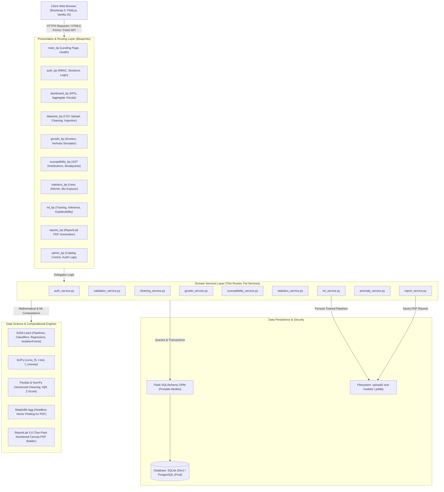
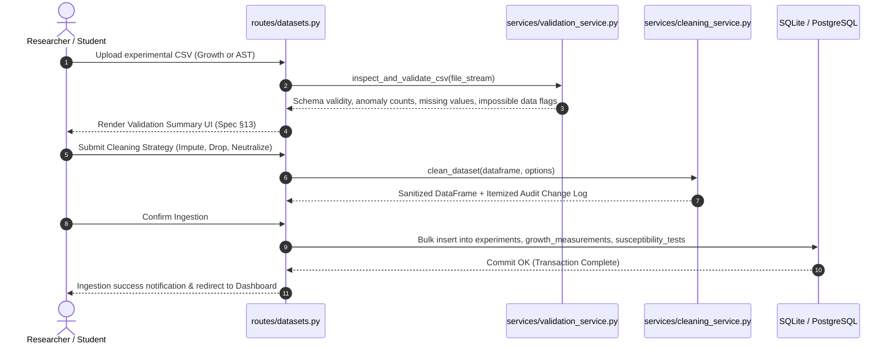

# BioSense System Architecture & Design Specification

**BioSense — Intelligent Microbial Growth & Antibiotic Susceptibility Analytics Platform**  
*Tagline: "Turning Biological Data into Intelligent Insights."*

---

## 1. High-Level Architectural Overview

BioSense is built using a decoupled, layered architectural pattern designed for high cohesion, strict separation of concerns, and rigorous testability. It adheres to the **Flask Application Factory (`create_app`)** pattern and utilizes **Blueprints** to organize domain modules.

### High-Level Architectural Flow

---

## 2. Layered Component Responsibilities

### 2.1 Presentation Layer (`routes/` & `templates/`)
- **Thin Controllers**: Route handlers are strictly responsible for parsing HTTP request parameters, authenticating user sessions, invoking corresponding service functions, flashing user feedback messages, and returning Jinja2 templates or JSON payloads.
- **Client-Side Rendering**: Interactive visualizations (Time vs OD curves, AST categorical donuts, Pearson heatmaps, ROC curves) are rendered client-side using **Plotly.js via CDN**, ensuring low server CPU load and interactive zoom/pan capabilities.
- **Biotechnological Design System**: Custom responsive CSS (`static/css/biosense.css`) implementing persistent light/dark theme toggle backed by `localStorage`, accessible color contrast, and laboratory badges.

### 2.2 Domain Services Layer (`services/`)
- **`auth_service.py`**: Manages user authentication, role enforcement (`@role_required("STUDENT", "RESEARCHER", "ADMIN")`), and security audit logging (`AuditLog`).
- **`validation_service.py`**: Validates uploaded CSV datasets against required column schemas, detects biological impossibility (negative OD600, pH outside 0.0–14.0, negative incubation hours), and flags data provenance.
- **`cleaning_service.py`**: Executes automated or guided data imputation (median OD for missing values), duplicate deduction, and **CSV formula injection neutralization** (`=, +, -, @` prefix stripping).
- **`growth_service.py`**: Computes non-linear curve fitting via SciPy `curve_fit` applying the Verhulst logistic growth model:
  $$N(t) = \frac{K}{1 + \left(\frac{K - N_0}{N_0}\right) e^{-r t}}$$
  Calculates maximum specific growth rate ($\mu_{max}$) via log-linear exponential slope and doubling time $t_d = \frac{\ln 2}{\mu_{max}}$.
- **`susceptibility_service.py`**: Aggregates clinical AST observations into Sensitive (S), Intermediate (I), and Resistant (R) categories based on CLSI M100/EUCAST disk diffusion breakpoints. Enforces strict dataset-derived phrasing without prescriptive clinical advice.
- **`statistics_service.py`**: Computes descriptive statistics (mean, median, standard deviation, IQR), Pearson correlation matrix, Welch's unequal variances t-test, and One-Way ANOVA across media and environmental conditions.
- **`ml_service.py`**: Manages Scikit-Learn training pipelines, hyperparameter configuration, model serialization to `models/*.joblib`, target leakage detection, and live inference.
- **`anomaly_service.py`**: Implements multi-model outlier screening on continuous growth and AST metrics using IQR, Z-score, and Isolation Forest.
- **`report_service.py`**: Compiles an end-to-end 13-section scientific dossier using ReportLab and headless Matplotlib Agg.

---

## 3. Data Ingestion & Transformation Lifecycle

---

## 4. Machine Learning & Predictive Modeling Architecture

### 4.1 Target Leakage Prevention & Feature Separation
In antimicrobial susceptibility testing (AST), the **zone of inhibition diameter (mm)** is the physical basis used by clinical microbiology standards (CLSI/EUCAST) to determine whether a culture is Sensitive or Resistant.
1. **Variant A (Zone Diameter Included)**: Serves as an academic baseline. Models achieve ~100% accuracy because the target classification is mechanically derived from this measurement. A clear warning of target leakage is displayed.
2. **Variant B (Genuine Predictive Model - Zone Diameter Excluded)**: Uses only pre-experimental biological predictors:
   $$\text{Features} = \{\text{Organism}, \text{Gram Type}, \text{Antibiotic Name}, \text{Antibiotic Class}, \text{Incubation Temp}, \text{Medium pH}\}$$
   Evaluates true supervised generalizability for susceptibility category prediction.

### 4.2 Pipeline Pipeline Workflow
Every model is instantiated inside a Scikit-Learn `Pipeline` with a `ColumnTransformer`:
- **Categorical Columns**: Imputed with most frequent, encoded via `OneHotEncoder(handle_unknown="ignore")`.
- **Numerical Columns**: Imputed with median, scaled via `StandardScaler()`.
- **Classifiers**: `LogisticRegression`, `DecisionTreeClassifier`, `RandomForestClassifier`.
- **Regressors**: `Ridge` (L2 regularization), `RandomForestRegressor`.

---

## 5. Security & Defensive Engineering Standards

| Security Requirement | Implementation in BioSense |
| :--- | :--- |
| **Authentication & RBAC** | Flask-Login with role hierarchy (`STUDENT`, `RESEARCHER`, `ADMIN`). Protected via `@role_required` decorator. |
| **Admin Bootstrap Restriction** | Public registration allows only `STUDENT` and `RESEARCHER`. The `ADMIN` role is strictly created via `scripts/create_admin.py` or environment variables. Privilege escalation attempts are rejected and logged to `audit_logs`. |
| **Password Hashing** | Secure password hashing using Werkzeug `generate_password_hash` with `scrypt` / `pbkdf2:sha256`. |
| **CSRF Protection** | Flask-WTF `CSRFProtect` applied globally to all POST, PUT, PATCH, and DELETE endpoints with meta tags and form inputs. |
| **Model Deserialization (Pickle/Joblib)** | Strict filesystem path verification (`is_safe_model_path`) ensures models are loaded only from the application's authorized `models/` directory. |
| **Spreadsheet Formula Injection** | CSV export cells starting with dangerous formula prefixes (`=`, `+`, `-`, `@`) are automatically escaped with a leading single quote `'`. |
| **File Upload Sanitation** | `secure_filename` prevents path traversal attacks. Uploads are strictly stored outside `static/` in a non-executable directory. |
| **Scientific Ethics Disclaimer** | Running footer on every page and generated PDF: *"Educational/Research Analytics — Not for Clinical Diagnosis or Treatment Decisions."* |
