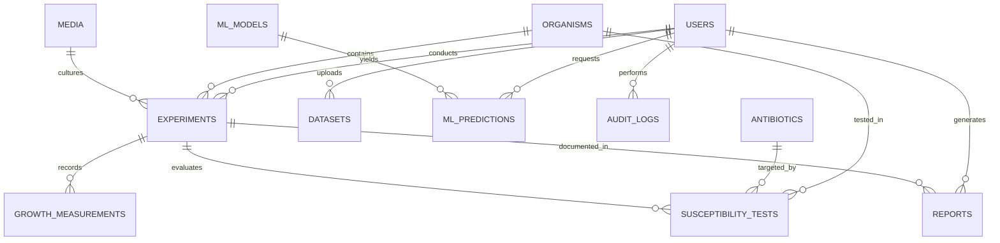

# BioSense Database Architecture & Entity-Relationship Schema

This document details the relational database architecture for the **BioSense** platform, implemented with Flask-SQLAlchemy. The design supports SQLite (for local development and testing) and PostgreSQL / MySQL in production via standard SQL dialect portability.

---

## 1. Entity-Relationship (ER) Diagram

---

## 2. Table Specifications & Attributes

### 2.1 `users`
Stores user identities, password hashes, and assigned role levels for RBAC.

| Column | Type | Constraints | Description |
| :--- | :--- | :--- | :--- |
| `id` | INTEGER | PRIMARY KEY, AUTOINCREMENT | Unique user identifier |
| `username` | VARCHAR(80) | UNIQUE, NOT NULL, INDEX | Login username |
| `email` | VARCHAR(120) | UNIQUE, NOT NULL, INDEX | Primary email address |
| `password_hash` | VARCHAR(255) | NOT NULL | Werkzeug-hashed secret (scrypt/pbkdf2) |
| `role` | VARCHAR(20) | NOT NULL, DEFAULT 'STUDENT' | Role: `STUDENT`, `RESEARCHER`, `ADMIN` |
| `created_at` | DATETIME | NOT NULL, DEFAULT UTC | Registration timestamp |

*Cascade:* Deleting a user cascades to their `experiments`, `datasets`, and `reports`.

---

### 2.2 `audit_logs`
Chronological, tamper-evident record of user and administrative actions.

| Column | Type | Constraints | Description |
| :--- | :--- | :--- | :--- |
| `id` | INTEGER | PRIMARY KEY, AUTOINCREMENT | Unique log entry ID |
| `user_id` | INTEGER | FOREIGN KEY (`users.id`, ON DELETE SET NULL) | Originating user ID |
| `action` | VARCHAR(100) | NOT NULL, INDEX | Event tag (e.g. `USER_LOGIN`, `MODEL_TRAINED`) |
| `details` | TEXT | NULLABLE | Detailed description of the event |
| `ip_address` | VARCHAR(45) | NULLABLE | Client IP address |
| `timestamp` | DATETIME | NOT NULL, INDEX, DEFAULT UTC | Event occurrence timestamp |

---

### 2.3 `organisms`
Standardized microbiological reference catalog.

| Column | Type | Constraints | Description |
| :--- | :--- | :--- | :--- |
| `id` | INTEGER | PRIMARY KEY, AUTOINCREMENT | Unique catalog ID |
| `scientific_name` | VARCHAR(120) | UNIQUE, NOT NULL, INDEX | Binomial scientific name (e.g. *E. coli*) |
| `common_name` | VARCHAR(120) | NULLABLE | Common colloquial name |
| `genus` | VARCHAR(60) | NULLABLE | Taxonomic genus |
| `species` | VARCHAR(60) | NULLABLE | Taxonomic species epithet |
| `gram_type` | VARCHAR(30) | NULLABLE | `Gram-negative`, `Gram-positive`, `Fungus` |
| `organism_type` | VARCHAR(50) | DEFAULT 'bacterium' | Biological classification |
| `domain_family` | VARCHAR(100) | NULLABLE | Taxonomic family (e.g. *Enterobacteriaceae*) |
| `description` | TEXT | NULLABLE | Reference notes & pathogenicity overview |

---

### 2.4 `antibiotics`
Antimicrobial agent reference catalog.

| Column | Type | Constraints | Description |
| :--- | :--- | :--- | :--- |
| `id` | INTEGER | PRIMARY KEY, AUTOINCREMENT | Unique antibiotic ID |
| `name` | VARCHAR(100) | UNIQUE, NOT NULL, INDEX | Pharmaceutical name (e.g. *Ciprofloxacin*) |
| `antibiotic_class` | VARCHAR(80) | NOT NULL | Drug class (e.g. *Fluoroquinolone*) |

---

### 2.5 `media`
Nutrient growth broth and media catalog.

| Column | Type | Constraints | Description |
| :--- | :--- | :--- | :--- |
| `id` | INTEGER | PRIMARY KEY, AUTOINCREMENT | Unique medium ID |
| `name` | VARCHAR(100) | UNIQUE, NOT NULL | Medium title (e.g. *Mueller-Hinton Broth*) |
| `composition` | TEXT | NULLABLE | Chemical formula or ingredients |
| `description` | TEXT | NULLABLE | Recommended culture conditions |

---

### 2.6 `experiments`
The central assay entity binding an organism, medium, environment, and dataset source.

| Column | Type | Constraints | Description |
| :--- | :--- | :--- | :--- |
| `id` | INTEGER | PRIMARY KEY, AUTOINCREMENT | Unique experiment run ID |
| `user_id` | INTEGER | FOREIGN KEY (`users.id`, ON DELETE CASCADE) | Investigator user ID |
| `organism_id` | INTEGER | FOREIGN KEY (`organisms.id`), NOT NULL | Target organism |
| `medium_id` | INTEGER | FOREIGN KEY (`media.id`), NOT NULL | Culture medium |
| `temperature` | FLOAT | NOT NULL | Incubation temperature (°C) |
| `ph` | FLOAT | NOT NULL | Initial medium pH (0.0 – 14.0) |
| `incubation_time_h` | FLOAT | DEFAULT 24.0 | Total protocol incubation duration |
| `data_source` | VARCHAR(50) | NOT NULL | `Synthetic – Demonstration Data`, `Public Dataset`, `User-Uploaded` |
| `notes` | TEXT | NULLABLE | Experimental observations |
| `created_at` | DATETIME | NOT NULL, DEFAULT UTC | Assay creation date |

---

### 2.7 `growth_measurements`
Time-series spectrophotometric optical density (OD600) readings.

| Column | Type | Constraints | Description |
| :--- | :--- | :--- | :--- |
| `id` | INTEGER | PRIMARY KEY, AUTOINCREMENT | Unique reading ID |
| `experiment_id` | INTEGER | FOREIGN KEY (`experiments.id`, ON DELETE CASCADE) | Parent experiment |
| `time_h` | FLOAT | NOT NULL, INDEX | Incubation time elapsed in hours |
| `optical_density` | FLOAT | NOT NULL | Absorbance value at 600nm (OD600) |
| `replicate_number` | INTEGER | DEFAULT 1 | Experimental replicate index |

---

### 2.8 `susceptibility_tests`
Clinical Kirby-Bauer disk diffusion AST measurements.

| Column | Type | Constraints | Description |
| :--- | :--- | :--- | :--- |
| `id` | INTEGER | PRIMARY KEY, AUTOINCREMENT | Unique susceptibility test record |
| `experiment_id` | INTEGER | FOREIGN KEY (`experiments.id`, ON DELETE CASCADE) | Linked assay run |
| `organism_id` | INTEGER | FOREIGN KEY (`organisms.id`), NOT NULL | Tested bacterial strain |
| `antibiotic_id` | INTEGER | FOREIGN KEY (`antibiotics.id`), NOT NULL | Tested antimicrobial agent |
| `concentration` | FLOAT | NULLABLE | Impregnated disk concentration ($\mu\text{g}$) |
| `zone_diameter_mm` | FLOAT | NULLABLE | Measured inhibition zone diameter (mm) |
| `category` | VARCHAR(2) | NOT NULL, INDEX | `S` (Sensitive), `I` (Intermediate), `R` (Resistant) |
| `data_source` | VARCHAR(50) | NOT NULL | Provenance attribution tag |

---

### 2.9 `datasets`
Registry of uploaded CSV files and ingestion state.

| Column | Type | Constraints | Description |
| :--- | :--- | :--- | :--- |
| `id` | INTEGER | PRIMARY KEY, AUTOINCREMENT | Dataset run ID |
| `user_id` | INTEGER | FOREIGN KEY (`users.id`, ON DELETE CASCADE) | Uploading user |
| `filename` | VARCHAR(255) | NOT NULL | Original file name |
| `filepath` | VARCHAR(255) | NOT NULL | Stored filesystem location |
| `row_count` | INTEGER | DEFAULT 0 | Raw line count |
| `rows_imported` | INTEGER | DEFAULT 0 | Successfully ingested rows |
| `rows_rejected` | INTEGER | DEFAULT 0 | Sanitized / dropped rows |
| `data_source` | VARCHAR(50) | NOT NULL | Provenance attribution tag |
| `status` | VARCHAR(30) | DEFAULT 'pending' | `pending`, `validated`, `cleaned`, `imported` |
| `created_at` | DATETIME | NOT NULL, DEFAULT UTC | Ingestion initiation date |

---

### 2.10 `ml_models`
Metadata tracking trained machine learning pipelines saved to disk.

| Column | Type | Constraints | Description |
| :--- | :--- | :--- | :--- |
| `id` | INTEGER | PRIMARY KEY, AUTOINCREMENT | Model registry ID |
| `name` | VARCHAR(120) | NOT NULL | Human-readable model title |
| `model_type` | VARCHAR(50) | NOT NULL | `classification_zone`, `classification_no_zone`, `regression` |
| `algorithm` | VARCHAR(80) | NOT NULL | Algorithm name (e.g. `Random Forest`) |
| `target` | VARCHAR(80) | NOT NULL | Predicted label (e.g. `category` or `optical_density`) |
| `features_json` | TEXT | NOT NULL | List of feature column names |
| `metrics_json` | TEXT | NOT NULL | JSON dictionary of performance metrics |
| `file_path` | VARCHAR(255) | NOT NULL | Location of `.joblib` artifact |
| `created_at` | DATETIME | NOT NULL, DEFAULT UTC | Training timestamp |

---

### 2.11 `ml_predictions`
Audit trail of live model inference calls.

| Column | Type | Constraints | Description |
| :--- | :--- | :--- | :--- |
| `id` | INTEGER | PRIMARY KEY, AUTOINCREMENT | Unique prediction record |
| `user_id` | INTEGER | FOREIGN KEY (`users.id`, ON DELETE CASCADE) | Calling user ID |
| `model_id` | INTEGER | FOREIGN KEY (`ml_models.id`, ON DELETE SET NULL) | Invoked model ID |
| `model_name` | VARCHAR(120) | NOT NULL | Snapshot of model name |
| `input_json` | TEXT | NOT NULL | Serialized feature inputs |
| `prediction` | VARCHAR(120) | NOT NULL | Output prediction |
| `probability_json` | TEXT | NULLABLE | Class probabilities dictionary |
| `created_at` | DATETIME | NOT NULL, DEFAULT UTC | Inference timestamp |

---

### 2.12 `reports`
Generated 13-section ReportLab scientific PDF dossiers.

| Column | Type | Constraints | Description |
| :--- | :--- | :--- | :--- |
| `id` | INTEGER | PRIMARY KEY, AUTOINCREMENT | Unique report identifier |
| `user_id` | INTEGER | FOREIGN KEY (`users.id`, ON DELETE CASCADE) | Author analyst ID |
| `experiment_id` | INTEGER | FOREIGN KEY (`experiments.id`, ON DELETE SET NULL) | Linked experiment |
| `title` | VARCHAR(255) | NOT NULL | Report title |
| `filename` | VARCHAR(255) | NOT NULL | Disk file name |
| `file_path` | VARCHAR(255) | NOT NULL | Physical file path |
| `created_at` | DATETIME | NOT NULL, DEFAULT UTC | Generation timestamp |
