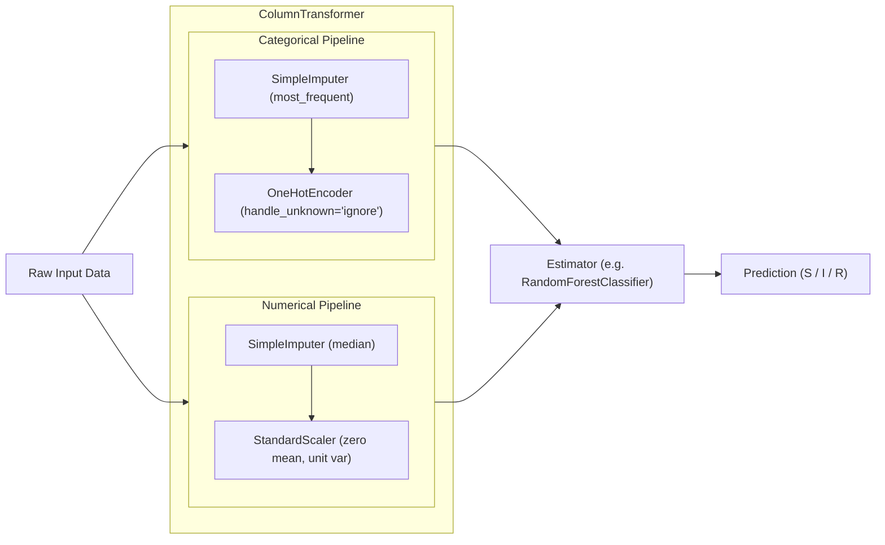

# BioSense Machine Learning Methodology & Predictive Analytics

**BioSense — Intelligent Microbial Growth & Antibiotic Susceptibility Analytics Platform**  
*Document Purpose: In-depth technical reference for final-year BCA (Data Science) viva defense and academic evaluation.*

---

## 1. Problem Formulation & Scientific Scope

In microbiology and clinical data science, predictive modeling is applied to two primary biological phenomena:
1. **Antimicrobial Susceptibility Testing (AST) Classification**: Categorizing bacterial response to an antibiotic into **Sensitive (S)**, **Intermediate (I)**, or **Resistant (R)** based on environmental, pharmacological, and taxonomic attributes.
2. **Microbial Growth Kinetics Regression**: Modeling the continuous spectrophotometric optical density (OD600) absorbance curve as a function of incubation time, temperature, and medium pH.

---

## 2. Target Leakage & The Dual Classification Formulations

A critical data science finding in BioSense is the formal distinction between **measurement-based categorization** and **pre-experimental predictive classification**.

### 2.1 Variant A: Baseline Categorization (Target Leakage Present)
* **Features Included**: `organism`, `gram_type`, `antibiotic`, `antibiotic_class`, `concentration`, `temperature`, `ph`, and **`zone_diameter_mm`**.
* **Target**: `category` (S / I / R).
* **Observation**: Models achieve ~99.5% – 100% test accuracy.
* **Why this occurs (Target Leakage)**: Clinical standards (CLSI M100 and EUCAST) define susceptibility categories using deterministic threshold cutoffs directly on the inhibition zone diameter (e.g., if $\text{zone} \ge 22\,\text{mm} \implies \text{Sensitive}$; if $\text{zone} \le 16\,\text{mm} \implies \text{Resistant}$). Including `zone_diameter_mm` in the feature matrix leaks the ground truth definition into the model.
* **Academic Value**: Demonstrates the student's mastery of **target leakage detection** during viva examination.

### 2.2 Variant B: Genuine Predictive Modeling (No Target Leakage)
* **Features Included**:
  $$\mathbf{X} = \{\text{organism}, \text{gram_type}, \text{antibiotic}, \text{antibiotic\_class}, \text{concentration}, \text{temperature}, \text{ph}\}$$
* **Excluded**: `zone_diameter_mm` is strictly withheld.
* **Target**: `category` (S / I / R).
* **Observation**: Realistic accuracy reflecting true biological association between bacterial taxa, antibiotic mechanisms of action, and environmental stress.

---

## 3. Preprocessing Architecture: Scikit-Learn Pipelines

To guarantee zero data contamination between training and evaluation partitions, all transformations occur inside an `sklearn.pipeline.Pipeline` with a `ColumnTransformer`.

### Preprocessing Specifications
1. **Stratified Train-Test Splitting**: Stratified 80/20 train/test split preserving the class distribution of S, I, and R.
2. **Fixed Random Seed**: `random_state=42` throughout to ensure mathematical reproducibility.
3. **Median Numerical Imputation**: Handles potential sensor dropouts without bias from extreme outliers.
4. **StandardScaler**: Computes $z = \frac{x - \mu}{\sigma}$ so regularized linear models (Logistic Regression, Ridge) are not biased by disparate feature scales.

---

## 4. Evaluated Machine Learning Algorithms

### 4.1 Classification Algorithms
1. **Multinomial Logistic Regression**:
   - Linear baseline with L2 penalty and `max_iter=1000`.
   - Useful for assessing linear separability in one-hot encoded biological feature space.
2. **Decision Tree Classifier (`criterion='gini'`, `max_depth=8`)**:
   - Interpretable tree-based segmentation mirroring clinical decision trees.
3. **Random Forest Classifier (`n_estimators=100`, `random_state=42`)**:
   - Ensemble of bootstrap aggregated decision trees providing variance reduction and robust ranking across biological features.

### 4.2 Regression Algorithms (OD600 Growth Prediction)
1. **Ridge Regression**: Linear model with L2 regularization penalty preventing collinearity between time and temperature.
2. **Random Forest Regressor**: Non-linear ensemble model capturing non-linear sigmoidal inflection points in bacterial growth.

---

## 5. Comprehensive Performance Evaluation Metrics

### 5.1 Classification Metrics
- **Accuracy**: Overall fraction of correct predictions:
  $$\text{Accuracy} = \frac{TP + TN}{TP + TN + FP + FN}$$
- **Macro-Averaged Precision & Recall**:
  $$\text{Macro Precision} = \frac{1}{C}\sum_{c=1}^C \frac{TP_c}{TP_c + FP_c}, \quad \text{Macro Recall} = \frac{1}{C}\sum_{c=1}^C \frac{TP_c}{TP_c + FN_c}$$
- **Macro-F1 Score**: Harmonic mean balancing precision and recall across imbalanced categories:
  $$F_1 = 2 \cdot \frac{\text{Precision} \cdot \text{Recall}}{\text{Precision} + \text{Recall}}$$
- **Multi-Class Confusion Matrix**: Visualized on a $3 \times 3$ grid displaying actual vs. predicted categories.

### 5.2 Regression Metrics
- **Mean Absolute Error (MAE)**: Average magnitude of optical density error:
  $$\text{MAE} = \frac{1}{n} \sum_{i=1}^n |y_i - \hat{y}_i|$$
- **Mean Squared Error (MSE)** & **Root Mean Squared Error (RMSE)**: Penalizes larger deviations heavily:
  $$\text{RMSE} = \sqrt{\frac{1}{n}\sum_{i=1}^n (y_i - \hat{y}_i)^2}$$
- **Coefficient of Determination ($R^2$)**: Proportion of variance in optical density explained by incubation parameters:
  $$R^2 = 1 - \frac{\sum (y_i - \hat{y}_i)^2}{\sum (y_i - \bar{y})^2}$$

---

## 6. Model Explainability & Permutation Importance

Model transparency is provided in `/ml/explain` via Scikit-Learn **Permutation Feature Importance**:
- Features are randomly shuffled on the validation set, and the drop in Macro-F1 score is measured.
- Higher drop indicates critical dependence on that attribute.
- **Viva Defense Caveat**: Feature importance indicates statistical association within the training dataset and **must not be conflated with biological causation or molecular mechanisms of resistance**.

---

## 7. Anomaly Screening Subsystem

Three distinct mathematical paradigms screen observations for outliers:
1. **Interquartile Range (IQR)**: Univariate outlier detection:
   $$\text{Lower} = Q_1 - 1.5 \times \text{IQR}, \quad \text{Upper} = Q_3 + 1.5 \times \text{IQR}$$
2. **Z-Score**: Identifies measurements exceeding $|Z| > 2.8$ standard deviations from the empirical mean.
3. **Isolation Forest**: Unsupervised ensemble algorithm that isolates anomalies using random partitioning trees. Anomalies are isolated closer to tree roots with shorter path lengths.

*Important Note*: An anomaly indicates statistical dispersion, not proof of measurement contamination or laboratory error.
